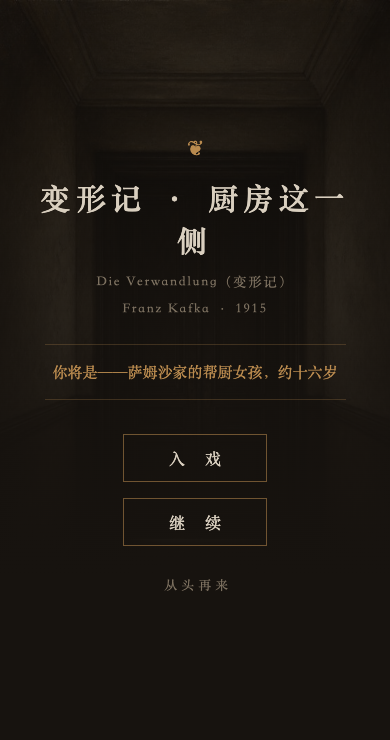
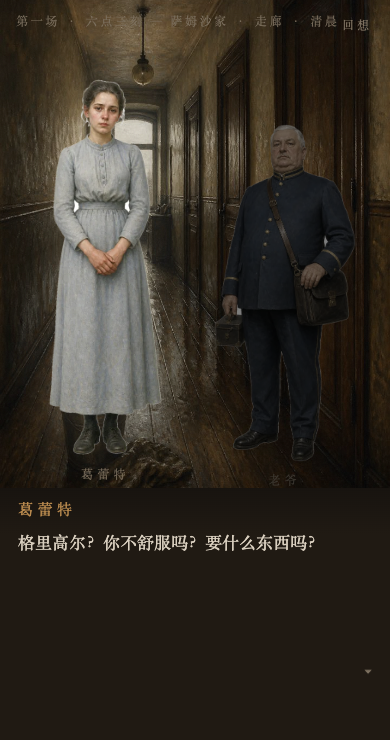
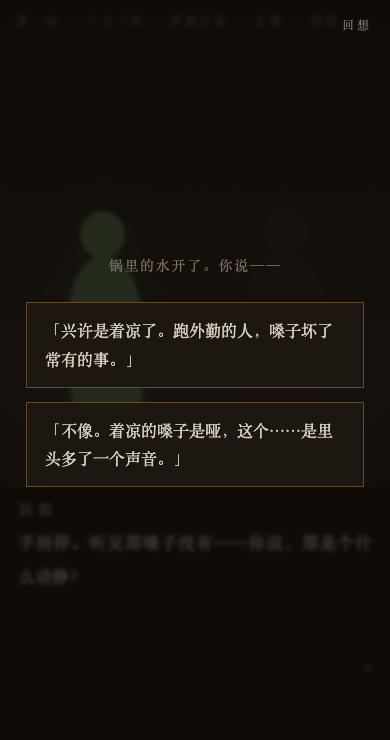
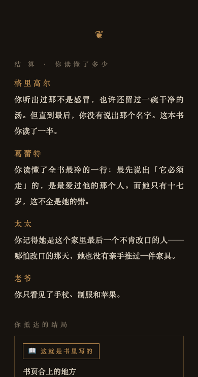

<div align="center">

# 📖 ruxi.skill — Step Into the Book

**Turn any book into a visual novel you can step into.**

One book → one double-click-to-play visual novel (galgame).
You play a character the original barely mentions, standing at decision points that genuinely exist in the text — choosing again.

**[🎮 Play the demos →](https://swaylq.github.io/ruxi-skill/)**

[中文](README.md) · [Website](https://swaylq.github.io/ruxi-skill/) · [MIT License](LICENSE) · Works with Claude Code / any skill-capable agent

</div>

---

> **Status**: v0.1 — pipeline complete. First full demo *The Metamorphosis: From the Kitchen Side* is playable: 13 scenes · 10 choice points · 3 endings · all 520 paths machine-verified · ~15-20 min per run · 54 KB single file.

## What it produces

Give it *The Metamorphosis*, get back an `index.html`:

> You are the Samsa family's sixteen-year-old kitchen girl — the novel gives her exactly one line: *"this girl of about sixteen bravely held out."*
>
> The morning of the transformation, you kneel in the hallway scrubbing floors. That voice comes through the door. The cook asks: "You heard that. What kind of sound was that, you'd say?"
>
> **▸ "A cold, most likely. Traveling men ruin their throats all the time."**
> **▸ "No. A cold makes you hoarse. This... this had a second voice inside it."**
>
> You pick the second. A line fades in at the corner of the screen:
> *Source: …ein nicht zu unterdrückendes, schmerzliches Piepsen mischte… (Ch. 1, the voice)*
> *You heard it. The whole family called it a cold. You heard it.*

<table><tr>
<td></td>
<td></td>
<td></td>
<td></td>
</tr></table>

At the end you don't get an "affection score." You get told **how much of this book you actually understood — and where you've been misreading it all along.**

## How this differs from "AI, write me a galgame"

Five iron rules. Break any one and the output degrades into a fanfic generator:

| # | Rule | What it prevents |
|---|---|---|
| 1 | Never cover the whole book — take 5-8 scenes | 300,000 words compressed into a highlight reel |
| 2 | The player defaults to **a character the book overlooks** | Protagonist mode (no suspense) and OC mode (fanfic drift) |
| 3 | **Every branch point must trace back to a sentence in the original**, cited in-game | Invented choices; play becomes a form of re-reading |
| 4 | No affection meter — an **understanding meter**: options are readings, not flattery | "Pick A to please her"; understanding a person and pleasing them often point opposite ways |
| 5 | One ending must be **what actually happens in the book** (canon) | All branches being equally arbitrary |

Closest existing tool is novel-to-game (novel → any game-genre prototype): not VN-focused, asks you to pick a platform, silent on copyright. ruxi does exactly one form, ships zero-install output, and copyright triage is Phase 0.

## Usage

```
you ❯ Turn The Metamorphosis into a game
```

Five phases (details in [SKILL.md](SKILL.md)):

```
0 Copyright triage   author's death year + first publication → PD / local-only, written into the artifact
1 Scan & pick        tools/scan_scenes.py computes "pressure" mechanically; the model only reads winning chapters
2 Cast the player    grep the text for overlooked side characters, verify 3 criteria, confirm with user
3 Write the script   one JSON (fixed schema), every choice point carries its source quote
4 Build & verify     build_html.py validates + builds; walk_script.py exhausts every path
```

Output: a self-contained `index.html` (no external requests, offline, mobile-friendly) + `CREDITS.md`.

### Pressure — picking the right scenes without feeding the book to a model

```
pressure = dialogue_ratio × exchanges ÷ people_present    (dense talk, many volleys, few people = a confrontation)
```

*Pride and Prejudice*, 124,116 words, 67 chapters — top three by pressure: the Netherfield drawing-room duel, Lady Catherine's ambush, Darcy vs. Elizabeth's first sparring. Exactly the sharpest scenes in the book. Pure Python stdlib, zero tokens.

## ⚡ Install

```bash
git clone https://github.com/swaylq/ruxi-skill ~/.claude/skills/ruxi-skill
```

Dependencies: Python ≥ 3.8, stdlib only. That's it.

## 🎮 Demos

| Book | You play | Central question | Status |
|---|---|---|---|
| *The Metamorphosis* (Kafka, 1915) | The sixteen-year-old kitchen girl | What if you don't lock that door? | ✅ [demos/metamorphosis](demos/metamorphosis/) |
| *Pride and Prejudice* (Austen, 1813) | Mrs. Hill, Longbourn's housekeeper | Half this family's respectability is locked in the servants' hall | ✅ [demos/pride](demos/pride/) |

## Copyright as pipeline, not disclaimer

- Adaptation is a derivative work — **it can infringe even with zero original text embedded**. Phase 0 triages every book into three tiers; copyrighted books build as "local play only" (watermarked footer, never distributed).
- **Translations carry their own copyright.** All quotes in the Metamorphosis demo come from the 1915 German first edition, translated in-house — the copyrighted English translation used for working reading contributed zero characters to the artifact.
- Full demos in this repo use public-domain books only. Every artifact ships a `CREDITS.md`.
- Engineering convention, not legal advice.

## Project structure

```
ruxi-skill/
├── SKILL.md                    # entry: 5-phase workflow + taste rules
├── prompts/                    # 3 checklists (scene/cast · writing · verification)
├── tools/
│   ├── scan_scenes.py          # EPUB/TXT → scene pressure table (zero-dep)
│   ├── build_html.py           # validate + build single-file index.html
│   ├── template.html           # VN engine (typewriter/sprites/branches/saves/verdict)
│   └── walk_script.py          # exhaust all paths: ending reachability + verdict coverage
├── references/
│   ├── adaptation.md           # methodology (the five rules, operationalized)
│   └── script-schema.md        # script JSON contract
└── demos/
    ├── metamorphosis/          # complete playable demo (Kafka)
    └── pride/                  # complete playable demo (Austen)
```

## License

MIT. Respect each book's own copyright status.

<div align="center">

*A good book deserves a second reading. The second time, from the inside.*

</div>
